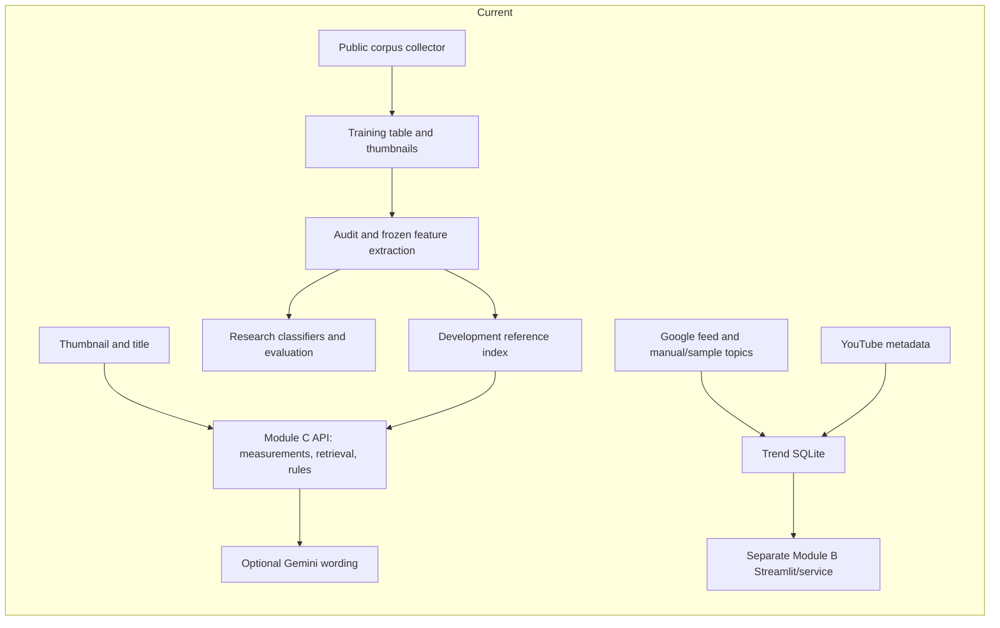
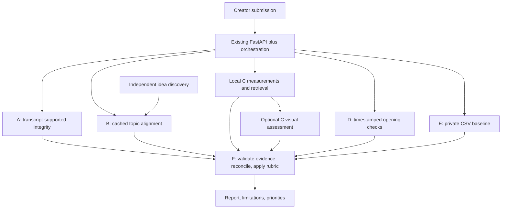

# Repository audit and implementation plan

**Recommendation: demonstrate an evidence-informed thumbnail advisor tomorrow, keep the trained predictors research-only, and integrate the six-module system incrementally.** Your choice of an offline presentation is appropriate: the strongest existing foundation is Module C’s diagnostic API and interface.

This audit used the local checkout at `95d8c41`, source code, documentation, existing evaluation artifacts, and read-only database queries. No files were changed, dependencies installed, models loaded, training performed, or paid APIs called.

All 46 inspected Python files passed syntax parsing. The reference-index hashes and training-table hash match their recorded manifests. Existing API/browser smoke artifacts report successful demonstrations, but I did **not** independently rerun those demonstrations or the test suite.

The three existing documentation modifications remain untouched.

## 1. Actual implementation and the five most consequential weaknesses

### Repository map

| Component | Verified implementation | Status and user-visible boundary |
|---|---|---|
| **A — Integrity** | No analyzer, transcript contract, or API implementation found. | **Planned.** Cannot currently verify title/content honesty. |
| **B — Trends** | Collectors, SQLite, keyword classification, embedding/TF-IDF retrieval, heuristic ranking, template ideas, optional Anthropic generation, Streamlit. | **Partial prototype.** Retrieves dated topics; does not establish Sri Lankan YouTube momentum. |
| **C — Packaging** | FastAPI upload analysis, image validation, visual measurements, CRAFT geometry, CLIP retrieval, rules, optional Gemini wording, browser UI, saved examples. | **Implemented diagnostic foundation.** Semantic design expertise and predictive usefulness remain unvalidated. |
| **D — Hook/retention** | No video/transcript analyzer or retention model found. | **Planned.** No implemented retention prediction. |
| **E — Channel history** | Public-data collector produces historical features; no private Studio CSV ingestion or personalization service. | **Planned product capability.** Public corpus preparation is not private-channel personalization. |
| **F — Fusion** | No shared orchestrator, module envelope, fusion rubric, or combined-report endpoint. | **Planned.** Module B and C remain separate applications. |

The actual API surface is visible in [app/main.py](/C:/Users/Janith/Desktop/Research-backend/creator-performance-backend/app/main.py:16) and [app/demo.py](/C:/Users/Janith/Desktop/Research-backend/creator-performance-backend/app/demo.py:61). `main.py` only imports Module C.

### Five highest-impact findings

| Finding | Classification / severity | Evidence and technical cause | Effect on creators and corrective direction |
|---|---|---|---|
| **1. The trained model does not justify performance advice.** | **Confirmed — Critical for research claims** | [RESULTS.md](/C:/Users/Janith/Desktop/Research-backend/creator-performance-backend/artifacts/module_c/research/y_rel_neighbors/RESULTS.md:3): combined AUROC **0.53191**, title/category **0.52742**; visual increment interval includes zero; combined Brier is worse than the prior. | A quality score or predicted edit uplift would give false precision. Preserve the experiment; withhold outcome predictions. |
| **2. The current advisor cannot answer much of the desired “thumbnail expert” brief.** | **Confirmed — High** | [features.py:89](/C:/Users/Janith/Desktop/Research-backend/creator-performance-backend/app/modules/module_c/features.py:89) measures global statistics and text geometry. [recommendations.py:6](/C:/Users/Janith/Desktop/Research-backend/creator-performance-backend/app/modules/module_c/recommendations.py:6) receives measurements/category/references, **not the title or image semantics**. | Different titles on the same image receive the same rule-selected advice. Subject visibility, emotional communication, cultural relevance, misleading visual promises, and genuine readability are not assessed. Add separately validated semantic/spatial findings. |
| **3. Trend outputs overstate the evidence available.** | **Confirmed — Critical for product claims** | [rank.py:21](/C:/Users/Janith/Desktop/Research-backend/trend-intelligence/retrieval/rank.py:21) uses last observation; `lifecycle()` interprets persistence as lifecycle; `trending_now()` uses recency and observation days. YouTube references do not participate in scoring. | “Trending,” “sustained,” or “off-trend” can mislead users. Separate source freshness, observed persistence, relevance, popularity, and unknown momentum. |
| **4. Local relevance and recommendation quality have not received human validation.** | **Confirmed — High; contribution to weak prediction Likely** | [audit.json](/C:/Users/Janith/Desktop/Research-backend/creator-performance-backend/artifacts/module_c/audit.json:11): substantial category imbalance and only 279 Tamil-script rows. All 18 recommendation-review rows and all 90 category/locality-review rows have blank judgments. All 356 discovery candidates are approved, but that does not establish manual review. | “Sri Lankan expert” and multilingual reliability claims exceed the evidence. Complete language-aware human review and correct future dataset versions without rewriting this study. |
| **5. The intended complete product has no integration layer or private-history path.** | **Confirmed — High** | [main.py:36](/C:/Users/Janith/Desktop/Research-backend/creator-performance-backend/app/main.py:36) exposes thumbnail analysis only; [trend service.py:11](/C:/Users/Janith/Desktop/Research-backend/trend-intelligence/service.py:11) returns an unrelated dictionary contract. No A/D/E/F implementation found. | A creator cannot obtain the requested integrated report. Add typed adapters and orchestration around working components; explicitly report unavailable modules. |

### Additional consequential defects

- **Collection scheduling is not operational as arranged in this monorepo.** The workflow is at [trend-intelligence/.github/workflows/collect_trends.yml](/C:/Users/Janith/Desktop/Research-backend/trend-intelligence/.github/workflows/collect_trends.yml:1). GitHub discovers workflows under the repository-root `.github/workflows`. Simply moving it is insufficient: its working directory and database paths also need correction, and its database commit conflicts with `.gitignore`. [GitHub workflow documentation](https://docs.github.com/en/actions/concepts/workflows-and-actions/workflows).
- **Sample persistence can look like observed history.** [manual_import.py:27](/C:/Users/Janith/Desktop/Research-backend/trend-intelligence/collectors/manual_import.py:27) manufactures daily observations across a supplied date span. Reimporting unchanged manual topics also refreshes their apparent relevance. Keep sample fixtures isolated and preserve original evidence dates.
- **The optional trend prompt explicitly permits unsupported claims.** [ideas.py:62](/C:/Users/Janith/Desktop/Research-backend/trend-intelligence/ideas.py:62) permits “rising” or “viral” when lifecycle is merely `new` or `sustained`. Its API call is outside the JSON-parsing exception handler; provider failures can abort analysis.
- **Feed publication dates are discarded.** [google_trends.py:42](/C:/Users/Janith/Desktop/Research-backend/trend-intelligence/collectors/google_trends.py:42) parses `pub_date`, but `run()` does not persist it. The schema also lacks region provenance and defaults language to English.
- **Module B may download a model during analysis.** [embedder.py:24](/C:/Users/Janith/Desktop/Research-backend/trend-intelligence/retrieval/embedder.py:24) has no explicit offline/backend selection. Add a deterministic TF-IDF mode for the presentation.
- **Research collection does not preserve historical packaging versions.** [yt_collector.py:136](/C:/Users/Janith/Desktop/Research-backend/data-collector/yt_collector.py:136) updates metadata in place, while `cmd_thumbs()` skips existing images. Later metadata refreshes can therefore pair newer titles/statistics with older downloaded thumbnails.
- **Review regeneration has inconsistent preservation behavior.** Module C’s report-review generator preserves judgments, but [audit.py:133](/C:/Users/Janith/Desktop/Research-backend/creator-performance-backend/app/modules/module_c/audit.py:133) blanks and overwrites channel-review columns. Do not rerun it over completed judgments.
- **Some architecture documentation is obsolete.** `TO-DO.md` and `compose.yaml` describe PostgreSQL/Redis infrastructure absent from the running API. Preserve them as historical proposals; remove them from the active setup instructions. Several backend README links omit the `docs/Module C/` directory.

## 2. Module C and ML research assessment

### Direct answer

**No—the current trained classifier is not suitable as the basis for telling a creator whether a new thumbnail will perform well or which edit will improve outcomes.**

**The surrounding diagnostic system is suitable for a limited demonstration:** measurements, mobile inspection, historical comparisons, and explicitly tentative design experiments.

These are separate conclusions. The API correctly enforces this separation: [schemas.py:62](/C:/Users/Janith/Desktop/Research-backend/creator-performance-backend/app/modules/module_c/schemas.py:62) declares both prediction fields as `None`, and `ThumbnailService` never loads the research estimators.

### What the existing experiment establishes

The stored study contains **24,163 training examples from 242 channels** and **5,989 test examples from 71 channels**. Test positives comprise approximately **50.48%**.

| Experiment | AUROC | Balanced accuracy | Brier ↓ |
|---|---:|---:|---:|
| Constant prior | 0.5000 | 0.5000 | **0.25001** |
| Visual measurements | 0.5089 | 0.5112 | 0.25032 |
| Title/category | 0.5274 | **0.5253** | 0.25046 |
| CLIP image features | 0.5239 | 0.5133 | 0.25636 |
| Combined | **0.5319** | 0.5227 | 0.27544 |

Combined-minus-title AUROC is **0.00449**, with the recorded channel-bootstrap interval **[-0.009148, 0.017295]**. Incremental visual benefit is not established.

The combined model has weak discrimination, rather than literally no signal: its recorded AUROC interval is above 0.5. That does not make it useful for individual advice. Its probability error exceeds the constant baseline; calibration has not been demonstrated. Brier alone does not isolate calibration from other probability errors.

The implementation already contains worthwhile safeguards:

- Channel-disjoint folds and duplicate-group purging.
- Train-only imputation, scaling, TF-IDF, and category encoding.
- An explicit predictive-feature allowlist excluding outcomes and channel history.
- Development-only regularization selection.
- Category/script slices, channel-balanced metrics, and paired channel bootstrapping.

These are verified in [evaluation.py:25](/C:/Users/Janith/Desktop/Research-backend/creator-performance-backend/app/modules/module_c/evaluation.py:25), `purged_split()`, `model_pipeline()`, and `run_evaluation()`. Preserve them.

### Why prediction is weak

**Confirmed target limitations**

[build_training_table.py:31](/C:/Users/Janith/Desktop/Research-backend/data-collector/build_training_table.py:31) defines:

```text
relative target =
    log(1 + collection-time views)
    − median log views of neighboring uploads

classification target = relative target > 0
```

This measures retrospective relative views, not CTR or thumbnail quality.

- The neighboring baseline includes later uploads.
- Outcome ages range from approximately **30 to 4,772 days**.
- Views reflect exposure, topic, creator audience, content, and time.
- Original publication-time titles/thumbnails are unknown.
- Small differences around zero become opposite classes.
- Channel-level categories can mislabel individual videos.

Using future neighbors **in a retrospective target is not itself feature leakage**. It does make that target unsuitable as a supposedly known pre-upload baseline.

A separate latent leakage problem affects future Module E experiments: `prev_*` selects earlier publications but uses statistics fetched later. Those measurements were not necessarily available when the target video was published. The current Module C estimator excludes these features, so this is **not evidence of leakage into the present C model**.

**Likely contributing causes**

- Label noise and uncontrolled exposure/topic effects dominate packaging effects.
- Global brightness/contrast and pooled CLIP embeddings poorly represent small text, hierarchy, and focal separation.
- The combined model’s AUROC-selected regularization (`C=10`) may permit overly extreme probabilities; this needs development-set reliability analysis.
- Search-based channel discovery and long-form filtering limit generalization to new/small creators and Shorts.

The artifacts cannot quantify each cause independently. A larger model is not the first defensible remedy.

### Component decisions

| Component | Decision |
|---|---|
| Image validation, padding, mobile preview | **Retain.** Useful and consistently applied. |
| Frozen CLIP embeddings | **Retain for retrieval.** No immediate fine-tuning. |
| Relative-view classifiers | **Keep research-only.** Preserve current results and fold 4. |
| CRAFT | **Retain as text-region detection.** Expose boxes; do not label it OCR/readability. |
| Recommendation rules | **Retain as cautious experiments.** Add semantic findings separately. |
| Retrieval | **Improve evaluation and abstention.** Current same-category/diversity/duplicate controls are useful, but there is no minimum relevance threshold. |
| Gemini wording adapter | **Retain its narrow boundary.** Introduce visual assessment through a different interface. |

`TextDetector` explicitly sets `recognizer=False` in [features.py:47](/C:/Users/Janith/Desktop/Research-backend/creator-performance-backend/app/modules/module_c/features.py:47). No thumbnail words are read.

English title-image cosine is correctly gated on explicit `title_language=en`. Sinhala, Tamil, mixed, and romanized Sinhala do not receive equivalent semantic analysis. Recorded Sinhala-script combined AUROC is **0.50697**; Tamil-script **0.67598** comes from only **177 test videos** and does not demonstrate Tamil language understanding.

Module B’s configured multilingual MiniLM model also does not list Sinhala or Tamil among its model-card languages. “Multilingual” is insufficient evidence of local support. [Model card](https://huggingface.co/sentence-transformers/paraphrase-multilingual-MiniLM-L12-v2).

### Research roadmap

Maintain three separately evaluated tracks:

1. **Useful advisor:** blind creator/designer assessment of observation accuracy, specific actions, retrieval relevance, language errors, and harmful advice. Compare rules-only, rules plus wording, and rules plus independent visual assessment.
2. **Relative-view research:** new versioned data with publication-time packaging and fixed 7-/30-day outcomes; channel-disjoint and future-period holdouts; stronger topic baselines; calibration fitted only on development data.
3. **CTR/retention forecasting:** explicit creator consent, real metric definitions and denominators, traffic-source/horizon controls, historical packaging versions, prospective validation, and controlled packaging experiments.

Public views, likes, and channel-normalized views cannot recover impressions CTR. A historical association also cannot establish redesign uplift.

Do not tune against fold 4 again. The existing human-review generator selects fold-4 examples; use those for documenting current limitations, and use a separate development review set when changing rules.

## 3. Architecture and Gemini blueprint

### Current versus proposed flow



There is no current connection from research classifiers to upload scoring, or from Module B to the FastAPI report.



Use one modular backend process. Keep collection as a separate command/scheduled task. SQLite and the existing NumPy index are sufficient; PostgreSQL, Redis, Celery, and a vector database are unnecessary for this scope.

### Interfaces and request flow

Preserve `POST /api/module-c/analyze`. Add these **proposed** interfaces in P1:

- `GET /api/trends/discover`: category, language, audience, optional topic preferences; no uploaded video required.
- `POST /api/trends/align`: proposed topic/title and optional description.
- `POST /api/analyze`: multipart thumbnail plus validated metadata; optional transcript and private CSV.
- `GET /api/status`: availability, capability versions, and source refresh status.

Create a shared `ModuleResult` with:

```text
module, schema_version, status,
generated_at, input_fingerprint,
findings[], evidence[], limitations[],
provider/model/ruleset versions, duration_ms
```

Statuses: `completed`, `partial`, `unavailable`, `failed`, `not_applicable`. Missing modules return explicit statuses, never average scores.

Use shared lowercase categories and language identifiers, including `si-Latn` for explicitly identified romanized Sinhala. Keep the current C endpoint compatible; carry richer language metadata in the new envelope.

Request sequence:

1. Validate inputs, limits, transcript completeness, and external-processing consent.
2. Parse CSV locally and prepare transcript segments.
3. Run B, local C, and E independently; A and D share immutable transcript segments.
4. Call optional semantic providers only where configured and consented.
5. Validate evidence references, transcript spans, and image regions.
6. Reconcile conflicts and merge duplicate recommendations.
7. Compute eligible rubric results deterministically.
8. Return the report and discard transient creator inputs.

Use bounded concurrency. Keep C’s existing inference lock; moving execution to threads does not make GPU work cancellable. Apply independent provider deadlines and preserve partial results.

Package Module B under a proper `trend_intelligence` namespace with relative imports. Its generic `import config`, `database`, and `retrieval` imports should not be integrated through permanent `sys.path` manipulation.

### Gemini: compare the two approaches

| Approach | Assessment |
|---|---|
| Local measurements/retrieval/rules + wording | Low integration risk and useful offline behavior. Cannot discover observations absent from the rules. |
| Local evidence + independent visual assessment + reconciliation | Better match for desired subject, composition, title complementarity, and regional observations. Adds privacy, hallucination, spatial accuracy, and evaluation obligations. |

**Choose the hybrid for P1, disabled by default.**

The existing [writers.py:27](/C:/Users/Janith/Desktop/Research-backend/creator-performance-backend/app/modules/module_c/writers.py:27) intentionally excludes images, titles, OCR, and CSVs. Do not quietly expand that payload. Add a separate `VisualAssessor`.

**Provider responsibilities**

- **A:** analyze title claims against supplied transcript/description and confirmed thumbnail text.
- **B:** classify/cluster supplied evidence and generate original angles, titles, and hooks. It cannot supply live popularity.
- **C:** inspect the uploaded image and title for hierarchy, subject visibility, text placement, clutter, complementary information, and curiosity.
- **D:** optionally assess opening structure from timestamped transcript evidence.
- **E:** no Gemini call in the MVP.
- **F:** deterministic fusion and templated narrative initially; no Gemini-generated final score.

For C, first request independent observations from the image/title/category/language. Reconcile them with local measurements afterward, avoiding a prompt that merely encourages agreement with existing rules.

Structured findings require:

```text
finding_id, criterion, observation, severity,
evidence_ids, optional region,
suggested_change, rationale, comparison_procedure,
uncertainty_reason
```

Regions use normalized `[x_min, y_min, x_max, y_max]` coordinates in the EXIF-oriented image. Validate ordering and bounds; map detector coordinates through resizing/padding. Label model regions **approximate**.

Gemini supports structured outputs and image-region responses, but schema validity does not establish visual correctness. [Structured outputs](https://ai.google.dev/gemini-api/docs/structured-output), [image understanding](https://ai.google.dev/gemini-api/docs/image-understanding).

Local numerical measurements remain immutable. Distinguish apparent conflicts: “low global contrast” and “clear subject edges” can both be true. Unresolved semantic disagreements remain visible and are excluded from scoring.

**Configuration and operating limits**

- Retain `google-genai`; start the pilot with configurable `gemini-3.5-flash-lite`. Compare against `gemini-3.8-flash` on the same human-reviewed fixtures before choosing a more expensive configuration. Neither is established as best for this task. Both are currently documented models. [Model catalog](https://ai.google.dev/gemini-api/docs/models).
- Keep wording’s eight-second deadline; give semantic calls a proposed 20-second deadline, bounded output, at most one transient retry, and shared request/token budgets.
- Never switch models, enable billing, or retry indefinitely.
- Cache only within the creator session by content hash, model, prompt/schema version, and consent scope; exclude raw inputs from logs.
- Missing key, timeout, invalid output, refusal, or exhausted budget preserves local C, B templates, E baselines, and explicit A/D limitations.

Current Flash-Lite standard rates are $0.30/M input and $2.50/M output tokens. An illustrative 3,000-input/1,200-output request is about **$0.0039**, including image tokens within that assumed input count; actual usage and thinking tokens determine cost. Latency is unmeasured. [Pricing](https://ai.google.dev/gemini-api/docs/pricing).

For private unreleased content, require explicit external-processing consent and a suitable provider account configuration. Google’s unpaid terms permit product-improvement use and prohibit submitting confidential/personal information; paid terms differ and still include limited abuse-monitoring retention. Private CSVs remain local regardless. [Gemini terms](https://ai.google.dev/gemini-api/terms).

### Minimal A and D behavior

A should identify supported, contradicted, and unverified promises, with exact transcript spans. “Supported by this transcript” is not independent verification that a factual claim is true.

Missing or incomplete transcripts must prevent a clean honesty verdict. Alternative titles must pass the same evidence checks. Keep curiosity findings owned by C.

D’s first realistic contribution is timestamped opening analysis: when the topic/value proposition appears, whether the opening addresses the stated promise, and identifiable repetition. Without timestamps, do not invent “time to value.” Video/audio pacing and numerical retention forecasts remain unavailable.

## 4. Trend intelligence, private personalization, and scoring specifications

### Module B: establish what the evidence supports

The inspected database contains:

- **25 Google Trends topics:** 19 Other, 5 Education, 1 Gaming, **0 Cooking**.
- **30 sample topics**, including all nine Cooking topics.
- **54 YouTube reference videos:** 51 Gaming, 1 Education, 2 Cooking.
- Latest topic/reference timestamps on **October 19, 2026**.

Several Education records are unrelated topics, including football entries. The database is not evidence of comprehensive current niche coverage.

Implement separate fields:

| Concept | Operational definition |
|---|---|
| Source freshness | Time since the source was successfully checked, including successful empty responses. |
| First observed | Earliest recorded appearance in this collection; not the topic’s real-world origin. |
| Publication date | Source-supplied date, preserved separately. |
| Popularity | Original source metric with units, region, window, and provenance; otherwise unknown. |
| Momentum | Change across comparable observations; otherwise unknown. |
| Creator relevance | Category, language, audience, and topic fit. |
| Alignment | Similarity to eligible evidence, separate from collection recency. |

Retain `0.7 × similarity + 0.3 × freshness` as an **experimental retrieval-ranking baseline**, not a calibrated trend score. Compare keyword, semantic, and recency-weighted ranking on human-labeled, date-frozen queries. Use backend-specific thresholds: TF-IDF and neural cosine are not interchangeable scales.

Replace `new/sustained/fading` with observation-based wording such as `first_observed_recently`, `repeatedly_observed`, and `not_recently_observed`. Set momentum and saturation to unknown until supported. No match means **insufficient matching evidence**, not a poor idea.

For collection:

- Maintain curated, reviewed Sri Lankan channel/category/language lists.
- Sample upload playlists and retrieve metadata in batches; use bounded search for discovery.
- Keep `mostPopular` as supplementary evidence. Since July 2025, its scope changed to Music, Movies, and Gaming charts, which helps explain why Education/Cooking chart coverage is unreliable. [YouTube revision history](https://developers.google.com/youtube/data/revision_history).
- Add source-run records and immutable permitted snapshots; deduplicate video IDs and cluster topics with persistent membership/provenance.
- Preserve Unicode combining marks during normalization.
- Treat English/Sinhala/Tamil/romanized/mixed relevance as an evaluation requirement, not a configuration flag.

YouTube’s current additional-metrics policy provides an amendment/acceptance route for specified derived analytics and extended statistical retention. Project acceptance is **Needs Verification**. Keep derived YouTube momentum disabled until the applicable use is confirmed; do not assume either unlimited research storage or a blanket permanent prohibition. [YouTube derived-metrics policy](https://developers.google.com/youtube/terms/derived-metrics-policy).

For P1 operations, use a local six-hour scheduled collector against persistent SQLite, recording last attempt/success/error. Warn after 12 hours without successful refresh. Do not commit mutable databases into Git.

### Module E: private CSV specification

Support per-video CSV exports first; identify aggregate/time-series exports and explain when they cannot support comparable-video baselines.

Normalize available columns into:

```text
video_id/title, published_date, duration_seconds,
format/category/language, reporting_window,
views, impressions, impressions_ctr,
average_view_duration_seconds, average_percentage_viewed
```

Store original header mapping, metric units, scope, missing values, and row-level validation errors.

**Validation defaults**

- UTF-8/BOM and common CSV delimiters; 5 MiB/10,000-row limit.
- Exclude total rows; detect duplicate IDs and overlapping periods.
- Parse percentages and durations explicitly. Ambiguous units require confirmation.
- Never turn blanks into zero or calculate CTR as total views/impressions.
- Do not combine mismatched reporting windows, traffic scopes, or duplicate aggregate/detail rows.
- Lifetime snapshots cannot establish fixed-horizon outcomes.
- Preserve replay-related percentage values with annotations rather than blindly clipping all percentages to 100.

**Baseline methodology**

- Primary baseline: per-video median and interquartile range, with count, date range, format, and metric scope.
- Comparable cohort: latest 20 eligible uploads of the same format, verified category/language where available, and duration between half and twice the proposed duration.
- Require at least 10 comparable videos for a “comparable cohort” summary. Otherwise fall back explicitly to the same-format channel history.
- With 5–9 eligible videos, show a limited descriptive baseline. With fewer than five, show individual history and insufficient-history status.
- Where compatible impressions and CTR exist, additionally report  
  `Σ(impressions × CTR) / Σ(impressions)` as an **impression-weighted historical rate**. Keep it distinct from the typical-video median.
- Do not add recency weighting or statistical shrinkage in the first release. The recent-upload cohort already limits historical drift. Compare those estimators later through chronological backtesting.

Without impressions, a provided CTR can support a median but not an impression-weighted rate. Without CTR, show only available view/watch-time history.

A proposed video has no observed outcome percentile. Personalization supplies context and comparable examples; it does not supply a supervised label for that video.

Default to request-local processing, no durable raw CSV storage, no external transmission, no pooled training, and no creator-data logs. Close/remove temporary files on completion or failure. Any later saved-history feature needs owner isolation, explicit retention, deletion of derived caches, and separate research consent.

Small/new creators receive fewer contextual statistics, **not a lower readiness score**.

### Module F: readiness rubric

**P0: no overall number.** Current measurements cannot fill a defensible readiness rubric.

For P1, use a versioned **heuristic editorial readiness** rubric:

| Owner | Weight | Criteria |
|---|---:|---|
| A | 35% | Main promise supported; consequential claims qualified; no material title/thumbnail/content contradiction. |
| C | 45% | Subject/hierarchy; mobile text clarity; focal separation; title-thumbnail complementarity and clear curiosity. |
| D | 20% | Opening states value; begins delivering the promise; avoids evidenced unnecessary repetition. |
| B | Context only | Timeliness/alignment does not determine whether evergreen content is ready. |
| E | Context only | Historical channel size/performance must not penalize content readiness. |

Each criterion receives `0 = evidenced major problem`, `1 = evidenced improvement needed`, `2 = evidence supports this criterion`, or `unknown`. Equal weights within each module; numeric mapping is backend-owned.

For assessed criteria:

```text
score = 100 × Σ(criterion_weight × rating / 2)
              / Σ(assessed criterion_weight)

coverage = Σ(assessed criterion_weight) / Σ(all criterion_weight)
```

Publish an overall score only when:

- All A criteria are assessable from sufficiently complete content.
- At least three C criteria are assessable.
- Weighted coverage is at least 70%.
- No unresolved serious integrity conflict exists.

Otherwise return `score: null` with reasons. Serious supported integrity concerns produce **“Revise claims before publishing”** and withhold the overall number; they cannot be averaged away by attractive packaging.

Interpretation: below 50, substantial evidenced revisions; 50–74, several revisions; 75–100, mostly meets the assessed checklist. These boundaries are initial editorial policy, not outcome-calibrated thresholds.

Display coverage separately from confidence. Confidence is qualitative and evidence-based; provider self-reported certainty is not a calibrated probability. Unvalidated semantic judgments keep the report marked experimental.

Own each issue once: truthfulness in A, curiosity/complementarity in C, opening delivery in D. F merges related actions without counting the same defect repeatedly.

The report contains the requested overall interpretation, B/C/A/D sections, E baseline when available, supported positives, major risks, three to five non-duplicated actions, and provenance/limitations. Do not manufacture positives or five actions when evidence supports fewer.

## 5. Prioritized patch plan, acceptance criteria, and demonstration

All tasks below are **proposed changes**, not changes made during this audit.

| Priority / task | Files or components | Solution and dependencies | Required tests and acceptance | Tomorrow? |
|---|---|---|---|---|
| **P0 — Freeze a reproducible demo** | Backend README, `docs/Module C/Module C next steps.md`, existing artifacts | Correct broken links; document exact offline startup and capability checks. Preserve weights, index, study, and user edits. **Small.** | One live upload plus saved example; predictions remain null; distinguish recorded from live output. | **Yes** |
| **P0 — Make B offline behavior explicit** | `trend-intelligence/config.py`, `retrieval/embedder.py` | Add explicit `tfidf` backend; prevent model acquisition during requests. **Small.** | Network-disabled analysis succeeds; backend is accurately reported. | **Yes, if demonstrating B** |
| **P0 — Correct B evidence wording** | `retrieval/rank.py`, `service.py`, `app.py`, `ideas.py` | Separate sample mode; show timestamps; replace unsupported trend/momentum claims; disable optional LLM for demo. **Small–medium.** | Sample-only Cooking is labeled sample; stale evidence stays stale; no-match means insufficient evidence. | **Yes, if demonstrating B** |
| **P0 — Review selected demonstrations** | Existing review CSVs, human reviewers | Review three presentation examples first; record findings without claiming full validation. **Depends on reviewers.** | Each displayed claim/action has checked evidence; local-language examples reviewed by a competent reader. | **Yes** |
| **P1 — Shared contracts and orchestration** | `app/main.py`; new `app/contracts.py`, `app/orchestration.py`, module adapters | Preserve C API; add independent discovery, alignment, and combined report. Package B imports properly. **Medium; first P1 dependency.** | Module failure cannot erase other results; null/status semantics; API compatibility and no-key E2E tests. | No |
| **P1 — Reliable trend collection** | `collect.py`, collectors, `database/db.py`, nested workflow | Add run ledger, original dates/region, sample isolation, read-only request connections, local schedule, expiry filtering. **Medium.** | Empty success vs failure; repeated imports; failed-source isolation; stale references; no database commits. | No |
| **P1 — Spatial C and optional Gemini** | C `features.py`, `schemas.py`, `service.py`; new visual-assessor/reconciliation adapter | Return normalized detector boxes; add independent visual findings and privacy gating. **Medium–large; depends on shared evidence contract.** | Invalid boxes, injected image text, invented metrics, conflicts, no consent/key, timeout, quotas, multilingual human review. | No |
| **P1 — A and minimal D** | New `app/modules/module_a/`, `module_d/` | Transcript-supported claims and timestamped opening checks. **Medium; provider/evidence dependency.** | Contradictions, missing/incomplete transcripts, unsupported alternatives, Sinhala/Tamil/mixed text, no false retention output. | No |
| **P1 — Private CSV E** | New `app/modules/module_e/` | Deterministic ingestion and baselines above. **Medium.** | Units, totals, duplicates, incompatible periods, missing impressions, tiny cohorts, cleanup, zero external transmission. | No |
| **P1 — F rubric and report** | New `app/modules/module_f/` | Deterministic gates, coverage, deduplication, priority ordering, contextual B/E. **Medium; depends on adapters.** | Missing modules do not imply average quality; severe A gate; small creator invariance; duplicate evidence counted once. | No |
| **P2 — Data and research validation** | Collector, `build_training_table.py`, C evaluation, separate future datasets | Point-in-time snapshots, packaging versions, reviewed labels, future/channel holdouts, development calibration, creator studies. **Large; consent/data dependent.** | No post-forecast inputs; fixed horizons; baseline superiority with intervals; untouched validation; language/channel subgroup review. | No |

The existing C tests cover important image, leakage, retrieval, provider, and UI boundaries. Module B’s tests primarily cover the YouTube collector. Add ranker, timestamp, classification, sample-isolation, and service-fallback tests before treating B as an integrated service.

Illustrative implementation boundaries:

```python
# Proposed: local results survive optional-provider failures.
local_c = await run_local_thumbnail_analysis(request)

visual_c = unavailable("external_processing_disabled")
if request.consent.visual_ai and settings.visual_ai_enabled:
    visual_c = await guarded_visual_assessment(request)

packaging = reconcile(local_c, visual_c)  # measurements stay immutable

# Proposed: no source evidence means uncertainty, not poor quality.
trend = {
    "alignment": alignment_or_none(eligible_matches),
    "momentum": None,
    "momentum_status": "insufficient_comparable_observations",
}

# Proposed: scoring cannot conceal incomplete evidence.
overall = score_readiness(results) if rubric_gates_pass(results) else None
```

### Minimal demonstration for October 23

1. **Module B:** demonstrate a clearly labeled sample Gaming idea, or manually checked dated evidence. Show source and October 19 observation dates. Do not describe it as today’s rising trend.
2. **Module C:** upload a new thumbnail and proposed title using the existing local studio.
3. Show its mobile preview, measured features, evidence-linked suggestion, and historical comparisons.
4. Upload an edited version and show **measured differences**, without announcing a predicted winner.
5. Explain the recorded held-out results and why forecasts remain unavailable.
6. Show A/D/E/F as unavailable or proposed in the architecture slide. Any CSV/report illustration must say **design example**, not working functionality.

Use `MODULE_C_WRITER=rules`, cached vision models, and the existing environment. Do not rerun extraction, training, or collection merely to refresh the presentation.

### Presentation-ready technical statement

> We are developing a multilingual assistant for Sri Lankan Gaming, Education, and Cooking creators, supporting idea discovery and pre-upload review.
>
> Our implemented thumbnail prototype measures image properties, retrieves historical comparisons, and offers evidence-linked design experiments. We evaluated five predictive baselines on 5,989 videos from 71 unseen channels. The combined model achieved AUROC 0.532, but improvement over title/category was uncertain and probability error was worse than the constant baseline, so outcome predictions remain disabled.
>
> Trend intelligence currently retrieves dated topics and reference videos; it does not yet validate rising YouTube trends. Our next step is a shared backend combining local measurements, optional structured Gemini assessment, transcript-supported integrity checks, and private channel baselines.
>
> The research contribution we aim to validate is locally relevant, multilingual, evidence-grounded advice with clear uncertainty—not an unvalidated claim to predict YouTube’s algorithm.

The remaining verification boundaries are explicit: current runtime readiness, expert usefulness, language-specific accuracy, provider account suitability, YouTube amendment acceptance, and prospective predictive validity have not been established by this read-only audit.
